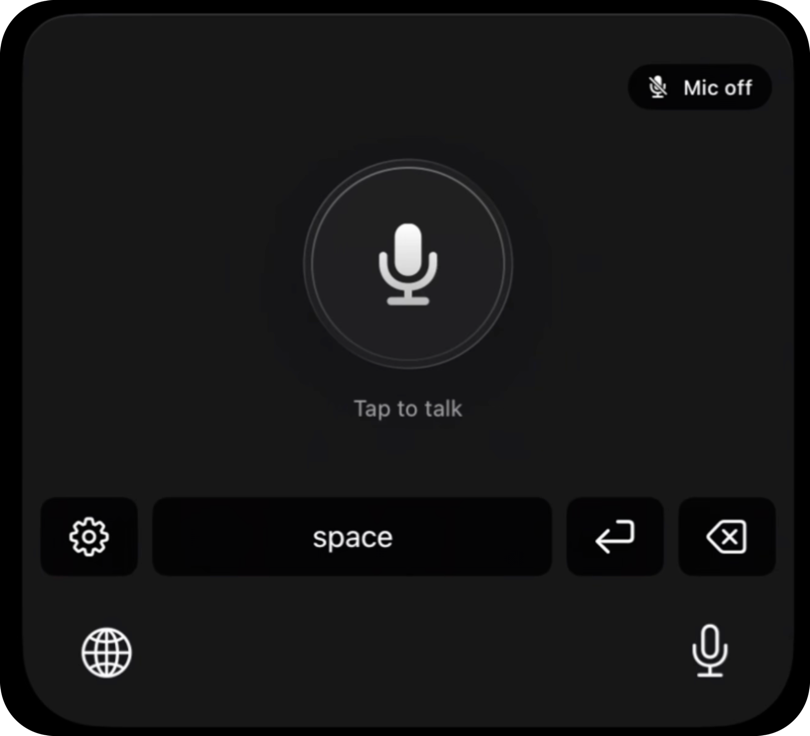

# hex-ios-keyboard

<p align="center">
  
</p>

An iPhone keyboard built around one button: **tap to talk, tap again to type.** Your voice is
transcribed on your Mac by [Hex](https://github.com/vkpdeveloper/anomaly-hex), and the text is
typed into whatever app you're using.

## How it works

```
 iPhone                                                Mac
┌──────────────────────────┐   start/stop   ┌───────────────────────┐
│ hex-ios-keyboard         │ ─────────────▶ │ hex-ios-keyboard app  │
│ (keyboard extension)     │                │ (records the mic)     │
│ tap → listen             │ ◀───────────── │                       │
│ tap again → type text    │   text         └──────────┬────────────┘
└──────────────────────────┘                           │ 16 kHz WAV over Wi-Fi
                                                       ▼
                                         ┌─────────────────────────────┐
                                         │ mac-server (Bun)            │
                                         │  ├─ Hex engine (Parakeet)   │
                                         │  ├─ dashboard :8787         │
                                         │  └─ history ~/.config/…     │
                                         └─────────────────────────────┘
```


## Requirements

- A Mac with [Hex](https://github.com/vkpdeveloper/anomaly-hex) installed in `/Applications`.
  The SDK doesn't ship its own speech engine yet, so the server runs the one inside `Hex.app`
  (`hex service --embedded`). The Hex app itself doesn't need to be open, and it can run at the
  same time: each keeps its own copy of the model in memory.
- [Bun](https://bun.sh) 1.1 or later
- Xcode 16 or later, and a free or paid Apple ID
- An iPhone on iOS 17 or later, on the **same Wi-Fi** as the Mac

## Run it

### 1. Start the Mac server

```bash
cd mac-server
bun install
bun start
```

The dashboard opens at <http://localhost:8787>. It walks you through the remaining steps and
ticks each one off as it's done. Leave this terminal running while you dictate.

### 2. Install the app on your iPhone

1. Plug in your iPhone and unlock it. If it asks, tap **Trust This Computer**.
2. In Xcode → **Settings → Accounts**, add your Apple ID.
3. Open `ios/hex-ios-keyboard.xcodeproj`.
4. Select the **VoiceKeyboard** target → **Signing & Capabilities** → choose your **Team**.
   The project is set up for team `TA2H8548F2`; to use a different one, change
   `DEVELOPMENT_TEAM` in `ios/project.yml` and run `xcodegen generate`. If the bundle ID is
   taken, change `com.niraj` there too.
5. Pick your iPhone at the top of the window and press **Run ▶**.
6. First time only, on the iPhone:
   - Settings → Privacy & Security → **Developer Mode** on (the phone restarts)
   - Settings → General → VPN & Device Management → tap your Apple ID → **Trust**

To build and install from the terminal instead, find your device ID with
`xcrun devicectl list devices` and run:

```bash
cd ios
xcodebuild -project hex-ios-keyboard.xcodeproj -scheme VoiceKeyboard \
  -destination 'platform=iOS,name=<your iPhone name>' \
  -allowProvisioningUpdates -derivedDataPath build build
xcrun devicectl device install app --device <device-id> \
  build/Build/Products/Debug-iphoneos/VoiceKeyboard.app
```

> With a free Apple ID, the app stops opening after 7 days. Press Run again to reinstall it.
> Your settings are kept.

### 3. Set up on the iPhone

Open **hex-ios-keyboard**. It shows three steps that tick themselves off. Once they're all done,
the steps hide and the app shows "You're all set" with the model your Mac is using; they come
back if anything breaks.

1. **Connect to your Mac.** Open the iPhone **Camera**, point it at the QR code on the
   dashboard, and tap the yellow link that appears. If you can't scan it, tap *Type the code
   instead* and enter the code shown on the dashboard. The app finds your Mac on the network, and
   finds it again if its IP changes.
2. **Allow the microphone.**
3. **Add the keyboard.** Tap **Open Settings** → **Keyboards** → turn on **hex-ios-keyboard**
   and **Allow Full Access**. Full Access lets the keyboard talk to the app and play haptics;
   your audio is only ever sent to your own Mac. Then switch to the keyboard once in the app's
   *Try it* box.

### 4. Dictate

In any app: tap 🌐 to switch to hex-ios-keyboard. **Tap** the mic. When you feel the tap and
see *Listening…*, talk. **Tap again** and the text is typed in.

- **Mic off** (top-right, while a session is running): turns the mic and the orange dot off.
- **⚙** opens the app, and **space**, **return** and **delete** work as usual.

## Mac dashboard

<http://localhost:8787> only opens on the Mac itself; other devices get `403`.

- **Status:** whether the server is running, the Hex engine's state (loading or ready) and
  whether your iPhone is connected, and over which route (home Wi-Fi or Tailscale)
- **Setup:** five steps, plus the pairing QR code until your phone connects. Once everything's
  green, this collapses into an "All set" card that names the model in use.
- **Reconnect iPhone** (top right): shows the pairing QR code at any time, even when everything
  is set up. Scan it to re-pair the phone; the popup closes by itself once the phone connects.
  The server keeps running, so if you don't scan, nothing changes.
- **Model:** pick which installed Hex model transcribes your dictations. Only models already
  installed in the Hex app are listed; nothing is downloaded from here. The choice is saved in
  `~/.config/hex-ios-keyboard/settings.json`.
- **Away from home:** whether Tailscale is running on this Mac, so the phone can reach it from
  anywhere (see below).
- **History:** every dictation's text, length and transcription time. You can search it, copy
  the text, open the folder in Finder, or clear it all.

**Audio is never stored.** Each clip is transcribed in memory and thrown away; only the text is
kept, in `~/.config/hex-ios-keyboard/history.jsonl`. The pairing code is in `token` in the same
folder; delete that file to make a new one, then pair the phone again.

### Server options

| Variable | Default | Description |
|---|---|---|
| `PORT` | `8787` | Port the server listens on |
| `HEX_MODEL` | the model picked on the dashboard, else `parakeet_unified_en` | Force a Hex model ID (list them with `hex model list`) |
| `HEX_LANGUAGE` | `en` | Language code passed to Hex |
| `HEX_BIN` | `/Applications/Hex.app/Contents/MacOS/hex` | Path to the Hex executable |
| `HEX_KEYBOARD_TOKEN` | stored in `~/.config/hex-ios-keyboard/token` | Override the pairing code |
| `NO_OPEN` | not set | Set to `1` to skip opening the dashboard in a browser |

## Dictate from anywhere (Tailscale)

At home the phone talks to the Mac over Wi-Fi. Away from home it can reach the Mac over
[Tailscale](https://tailscale.com), a private network between your own devices (free for
personal use).

1. Install Tailscale on the Mac and the iPhone, and sign in to both with the same account.
   On the iPhone, turn on **VPN On Demand** so it stays connected.
2. Keep the Mac awake while you're out: System Settings → Battery → **Prevent automatic
   sleeping when the display is off** (on power), with `bun start` running.
3. That's it. The server finds its Tailscale address by itself (via `tailscale status`, checked
   every 15 seconds) and sends it to the phone; no need to re-scan the QR code.

The app always tries home Wi-Fi first (it's faster) and switches to Tailscale the moment you
leave, and back again when you're home. The app and the dashboard show which route is in use.
Over Tailscale's relay a dictation takes a few hundred milliseconds longer. The audio stays
encrypted between your own devices the whole way.

## Microphone sessions

iOS only lets an app start the mic while it's on screen; started from the background, it records
silence. So a session keeps the mic running in the background (orange dot), and audio is only
kept while you're dictating. Everything else is thrown away on the phone.

A session ends after the time you pick in the app under **Microphone → Keep the mic ready for**
(1, 5, 15, 30 or 60 minutes, or until you turn it off; 5 by default). You can also end it with
**Mic off** on the keyboard or **Turn off** in the app. After a call or Siri, the session
resumes if iOS gives the mic back.

## History on the phone

In the app, tap **Show history** to see everything you've dictated, newest first, with
timestamps. It's text only; the audio stays on the Mac. Tap the copy icon, swipe left, or
long-press to copy. You can search it and pull to refresh, and new dictations appear as soon as
the Mac transcribes them.

## Troubleshooting

| What you see | What to do |
|---|---|
| "Can't find your Mac" | Check that `bun start` is running and both devices are on the same Wi-Fi. On the Mac, allow incoming connections for `bun` (System Settings → Network → Firewall). |
| Tapping the mic does nothing | Turn on **Allow Full Access** for hex-ios-keyboard. |
| The keyboard opens the app every time | That's how a new session starts. Raise **Keep the mic ready for** to need this less often. |
| It doesn't go back to my app by itself | That app isn't in the list in `ios/VoiceKeyboard/ReturnToPreviousApp.swift`. Swipe back or tap **Back to <App>** for now; the debug log's `host app seen:` line shows its bundle ID so it can be added. |
| "Untrusted Developer" or the app won't open | Settings → General → VPN & Device Management → trust your Apple ID. With a free Apple ID, reinstall from Xcode every 7 days. |
| Text comes back empty | The clip was probably silent. Tap **Mic off** and dictate again to start a fresh session. |
| "Can't reach your Mac" away from home | Check that Tailscale is connected on both devices, the Mac is awake and `bun start` is running. The dashboard's **Away from home** card shows whether the Mac is on Tailscale. |
| Hex engine shows "Not working" | Check that Hex is in `/Applications`, or set `HEX_BIN`. The error is shown on the dashboard. |

## Project layout

```
mac-server/
  server.ts          Bridge to Hex: POST /transcribe, GET /health, GET /history, WebSocket /ws,
                     Bonjour, dashboard API
  dashboard.html     Setup, status and history page
ios/
  project.yml        XcodeGen spec (the .xcodeproj is generated from this)
  VoiceKeyboard/     The app: setup screen, background recorder, Mac connection, history
  Keyboard/          The keyboard extension: tap-to-talk UI and haptics
  Shared/            State shared through the App Group, Darwin notifications, debug log
  tools/make_icon.py Draws the app icon
```

How the pieces talk to each other:

- **Keyboard → app:** Darwin notifications (`start`, `stop`, `cancel`, `endSession`)
- **App → keyboard:** `state.json` in the App Group container (`group.com.niraj.voicekeyboard`),
  plus a `stateChanged` Darwin notification on every change so the keyboard reacts immediately
- **App → Mac:** `POST /transcribe` with a WAV body and `Authorization: Bearer <code>`
- **Mac → app:** a WebSocket at `/ws?token=<code>` that pushes engine status and new history
  entries; the app reconnects within a second when the server comes back
- **Pairing:** the QR code encodes `voicekb://pair?url=…&token=…`

### Development

- After adding or renaming files under `ios/`, run `xcodegen generate` in `ios/`
  (`brew install xcodegen`).
- To redraw the icon: `python3 ios/tools/make_icon.py ios/VoiceKeyboard/Assets.xcassets/AppIcon.appiconset/AppIcon.png`
  (needs Pillow).
- To type-check the server: `cd mac-server && bunx tsc --noEmit`.
- The keyboard and the app both write to `Library/debug.log` in the App Group. Pull it with
  `xcrun devicectl device copy from --device <id> --domain-type appGroupDataContainer --domain-identifier group.com.niraj.voicekeyboard --source Library/debug.log --destination debug.log`.
